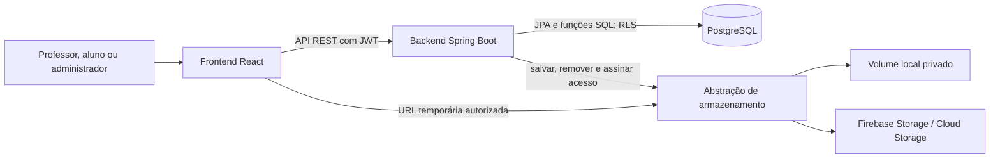

# Ideia Space

Repositório digital para organizar materiais acadêmicos e disponibilizá-los a professores e alunos com controle de acesso por perfil e vínculo com as turmas. O sistema reúne a administração de usuários, disciplinas, turmas e conteúdos em uma aplicação web, com armazenamento privado e registro de acessos.

> A proteção no navegador reduz a exposição e registra eventos, mas não impede capturas feitas por outro dispositivo. O projeto não promete proteção absoluta contra cópia.

## Navegação

- [Funcionalidades](#funcionalidades)
- [Arquitetura e tecnologias](#arquitetura-e-tecnologias)
- [Estrutura do repositório](#estrutura-do-repositório)
- [Pré-requisitos](#pré-requisitos)
- [Executar localmente no Windows](#executar-localmente-no-windows)
- [Armazenamento de arquivos](#armazenamento-de-arquivos)
- [Banco de dados e testes](#banco-de-dados-e-testes)
- [Documentação complementar](#documentação-complementar)
- [Contexto acadêmico](#contexto-acadêmico)

## Funcionalidades

- Login com token JWT e autorização por perfil (`ADMIN`, `DOCENTE`, `ALUNO`). O provisionamento de contas é restrito a administradores.
- Administração de usuários, disciplinas, turmas e vínculos de participantes.
- Cadastro, publicação, edição e exclusão lógica de materiais vinculados a turmas.
- Upload de PDFs e vídeos MP4/WebM com validação de conteúdo e limites configuráveis no backend.
- Acesso a conteúdo condicionado ao perfil, à publicação e ao vínculo acadêmico.
- Visualizador de PDF e player de vídeo no frontend, com marca d'água e eventos de proteção como medidas dissuasivas.
- Armazenamento privado local ou no Google Cloud Storage por meio do Firebase Storage; URLs temporárias são emitidas pelo backend após autorização.
- Auditoria de aberturas, tentativas de acesso negado e eventos reportados pelo navegador.
- Row-Level Security (RLS) no PostgreSQL como camada adicional de isolamento dos dados.

## Arquitetura e tecnologias



| Camada | Tecnologias utilizadas |
|---|---|
| Frontend | React 19, TypeScript, Vite 8, React Router 7, Tailwind CSS 4, Lucide React e PDF.js |
| Backend | Java 21, Spring Boot 4.1, Spring Web, Spring Security, Spring Data JPA e Maven Wrapper |
| Dados | PostgreSQL 18, Flyway e Row-Level Security (RLS) |
| Arquivos | Interface `ObjectStorage`, implementação local e implementação Firebase/Google Cloud Storage |

O frontend usa a API em `http://localhost:8081` por padrão. O modo mock é controlado por `VITE_USE_MOCKS`; confira `frontend/.env.example`. A autenticação também pode ser simulada separadamente por `VITE_USE_MOCK_AUTH`.

## Estrutura do repositório

```text
.
├── AGENTS.md                       # orientações permanentes para agentes de programação
├── backend/
│   ├── compose.yaml                # PostgreSQL e backend em Docker Compose
│   ├── docs/                       # instruções específicas do armazenamento Firebase
│   └── ideiaspace/
│       ├── src/main/java/          # aplicação Spring Boot
│       ├── src/main/resources/     # configuração e migrations Flyway
│       ├── src/test/               # testes unitários e de integração
│       └── pom.xml
├── docs/                           # banco, custos e entregas acadêmicas
├── frontend/
│   ├── docs/                       # contrato da API e matriz de requisitos
│   ├── public/                     # recursos estáticos e materiais de demonstração
│   ├── src/                        # interface, serviços e testes dos adapters
│   ├── package.json
│   └── vite.config.ts
├── GUIA-INICIO-IDEIA-SPACE.md      # guia operacional detalhado
└── README.md
```

## Pré-requisitos

- Windows 10/11 com PowerShell.
- Java 21 para executar o backend fora de Docker ou rodar os testes Maven.
- Node.js `>=20.19` e npm (requisito definido em `frontend/package.json`).
- Docker Desktop com Docker Compose v2 para executar banco e backend em containers.
- Git para obter e atualizar o repositório.

Confira as ferramentas instaladas:

```powershell
git --version
java -version
node --version
npm --version
docker --version
docker compose version
```

## Executar localmente no Windows

### 1. Obter o repositório

Se ainda não tiver uma cópia local, use o endereço Git fornecido pela equipe:

```powershell
git clone <URL_DO_REPOSITORIO> IdeiaSpace
Set-Location .\IdeiaSpace
```

Se já está no repositório, siga para o próximo passo.

### 2. Configurar e iniciar PostgreSQL e backend

O arquivo de configuração do Compose fica em `backend/`. Crie o arquivo local a partir do modelo apenas se ainda não existir, preencha-o localmente e não o versione:

```powershell
Set-Location .\backend
if (-not (Test-Path .env)) { Copy-Item .env.example .env }
notepad .env
docker compose up -d --build
docker compose ps
```

O Compose publica PostgreSQL em `localhost:5434` e a API em `http://localhost:8081`. As migrations Flyway são executadas no início do backend. O armazenamento local de uploads usa o volume Docker `uploads_data`; os dados do PostgreSQL ficam em `postgres_data`. `docker compose down` para os serviços sem remover esses volumes.

Variáveis obrigatórias do Compose, sem valores secretos:

| Variável | Uso |
|---|---|
| `POSTGRES_PASSWORD` | Senha do usuário de administração do PostgreSQL usada pelo Compose e Flyway |
| `APP_BACKEND_DB_PASSWORD` | Senha da role restrita `app_backend` usada pelo backend |
| `APP_JWT_SECRET` | Assinatura dos tokens JWT |
| `APP_CPF_KEY` | Chave exigida pela configuração de segurança |
| `APP_CPF_HMAC_KEY` | Chave HMAC exigida pela configuração de segurança |

O modelo também documenta variáveis opcionais para limites de upload, CORS, tempo de vida do token, armazenamento e criação inicial de administrador. O bootstrap de administrador só é usado quando configurado e ainda não existe um administrador. Para execução fora do Compose, configure as variáveis correspondentes no ambiente do processo ou na IDE; o Spring/Maven não carrega automaticamente `backend/.env`.

### 3. Iniciar o frontend

Em outro terminal PowerShell, a partir da raiz:

```powershell
Set-Location .\frontend
if (-not (Test-Path .env)) { Copy-Item .env.example .env }
npm ci
npm run dev
```

O Vite disponibiliza a interface em `http://localhost:5173`. O `.env.example` define a URL da API e os limites de validação de experiência do usuário. Os limites efetivos de upload são impostos pelo backend.

### 4. Verificar os serviços

```powershell
# Backend/API: a rota exige autenticação; uma resposta HTTP confirma que a API atende.
curl.exe -i http://localhost:8081/api/v1/conteudos

# Estado dos containers e PostgreSQL
docker compose ps
docker compose exec db pg_isready -U postgres -d ideiaspace
```

A rota de conteúdos requer token; sem token é esperado `401`. Para configurar o primeiro administrador ou cadastrar dados acadêmicos, siga o [guia de início](GUIA-INICIO-IDEIA-SPACE.md).

## Armazenamento de arquivos

### Local

É o provedor padrão para desenvolvimento e testes (`APP_STORAGE_PROVIDER=local`). Os arquivos são gravados fora de conteúdo estático, em armazenamento privado. No Compose, o volume `uploads_data` mantém os arquivos entre reinicializações e recriações dos containers. Não requer credenciais Firebase.

### Firebase Storage / Cloud Storage

O backend contém um provedor Firebase, responsável por validar, enviar e remover objetos, além de emitir URLs temporárias assinadas depois de autorizar o acesso. As credenciais não são entregues ao frontend. A integração real não foi validada contra um bucket.

O projeto Firebase identificado pela equipe é `ideia-sapce`. O projeto está no plano Spark; o acesso real ao Cloud Storage depende da migração para Blaze e da configuração de um bucket e uma credencial de serviço. A equipe deve confirmar o ID no Console. Consulte o [guia oficial de configuração Firebase do repositório](backend/docs/FIREBASE_SETUP.md) antes de habilitar o provedor. O documento [FIREBASE_CUSTOS.md](docs/FIREBASE_CUSTOS.md) contém estimativas preliminares, não uma cotação vigente.

## Banco de dados e testes

O banco de desenvolvimento é `ideiaspace`, PostgreSQL 18.6 no Compose. Flyway aplica as migrations versionadas automaticamente. RLS protege tabelas como usuários, turmas, vínculos, conteúdos e registros de acesso. A role da aplicação não deve ser `SUPERUSER` nem possuir `BYPASSRLS`; `app_owner` é usada pelas migrations e funções privilegiadas específicas.

Para uma inspeção local do banco no container:

```powershell
Set-Location .\backend
docker compose exec db psql -U postgres -d ideiaspace
```

O acesso administrativo acima é apenas para manutenção/inspeção local; a aplicação conecta como `app_backend`. O guia do [banco de dados e RLS](docs/README_DATABASE.md) descreve as migrations, as entidades e a preparação do banco de testes. Os testes de integração usam o banco isolado `ideiaspace_test`, não o banco de desenvolvimento. As propriedades de teste documentam as variáveis `SPRING_TEST_DATASOURCE_PASSWORD` e `SPRING_TEST_FLYWAY_PASSWORD`; configure-as no ambiente do Maven. Ajuste `SPRING_TEST_DATASOURCE_URL` se o PostgreSQL estiver publicado em outra porta.

### Testes do backend

Execute a partir de `backend/ideiaspace/`:

```powershell
.\mvnw.cmd -DskipTests compile
.\mvnw.cmd test
.\mvnw.cmd clean test
```

O primeiro comando compila sem executar testes; os dois últimos executam a suíte. Os testes de integração precisam do PostgreSQL de testes configurado e disponível.

### Verificações do frontend

Execute a partir de `frontend/`:

```powershell
npm ci
npm run typecheck
npm run build
```

Os adapters também têm testes automatizados. `npm run test:integration` exercita chamadas HTTP contra o backend e exige uma API e dados de integração preparados em ambiente de teste; não use dados de produção. `npm run test:content` inicia um servidor HTTP local simulado e não substitui os testes com backend real. Os scripts npm encerram removendo diretórios com `rm -rf`; em PowerShell do Windows, execute as etapas equivalentes diretamente:

```powershell
# Teste local do adapter de visualização
npx vite build --ssr src/tests/test-content-access.ts --outDir dist/test-content
if ($LASTEXITCODE -ne 0) { throw "Falha na compilação do teste de conteúdo" }
node dist/test-content/test-content-access.js
if ($LASTEXITCODE -ne 0) { throw "Falha no teste do adapter de conteúdo" }
Remove-Item -LiteralPath dist/test-content -Recurse -Force

# Integração HTTP com backend e contas preparadas
npx vite build --ssr src/tests/test-materials-e2e.ts --outDir dist/test
if ($LASTEXITCODE -ne 0) { throw "Falha na compilação do teste de integração" }
node dist/test/test-materials-e2e.js
if ($LASTEXITCODE -ne 0) { throw "Falha no teste de integração com backend" }
Remove-Item -LiteralPath dist/test -Recurse -Force
```

### Resultados registrados

- **Backend automatizado:** os relatórios Surefire atualmente presentes no workspace registram 168 testes aprovados, 0 falhas, 0 erros e 0 ignorados, em 17 suítes. Os relatórios foram atualizados em 17/11/2026 entre 15:23:11 e 15:23:21 (horário local). Esta revisão documental não repetiu a suíte.
- **Frontend:** a última informação registrada nesta sessão antes desta revisão foi de TypeScript, build e adapter de visualização aprovados; não foram repetidos nesta alteração documental.
- **Armazenamento local:** coberto por testes automatizados unitários e de integração do provedor local.
- **Firebase real:** não testado contra bucket real; os testes Firebase existentes usam armazenamento simulado.
- **Testes manuais:** não foram executados nesta revisão documental.

## Documentação complementar

| Documento | Conteúdo |
|---|---|
| [Guia de início](GUIA-INICIO-IDEIA-SPACE.md) | Configuração operacional, primeiro administrador e fluxo de uso |
| [Banco de dados](docs/README_DATABASE.md) | PostgreSQL, migrations, RLS, entidades e ambiente de testes |
| [Firebase Storage](backend/docs/FIREBASE_SETUP.md) | Configuração de credenciais, bucket privado, CORS e validação futura |
| [Contrato de integração da API](frontend/docs/API_CONTRACT.md) | Endpoints implementados e propostas ainda em avaliação |
| [Requisitos do frontend](frontend/docs/REQUISITOS_E_INCONSISTENCIAS.md) | Matriz de requisitos e decisões de implementação |
| [Relatório da Fase 0](backend/FASE0_RELATORIO.md) | Registro histórico da revisão inicial de segurança |
| [Estudo preliminar de custos](docs/FIREBASE_CUSTOS.md) | Estimativas históricas; confirmar preços e condições atuais antes de decisões financeiras |
| [Proposta de arquitetura de banco e segurança](docs/Proposta_Arquitetura_Banco_Dados_Seguranca_Midias.pdf) | Documento acadêmico de proposta |
| [Relatório de implementação V2.1](docs/Relatorio_Implementacao_V2_1.pdf) | Registro acadêmico da camada de banco e segurança |
| [Visualização e proteção](<docs/Grupo 4_ Visualização e Proteção.pdf>) | Documento de requisitos acadêmicos sobre visualização |
| [Documentação do protótipo Figma](docs/Documentacao_do_Projeto_Figma.pdf) | Registro do protótipo visual |

## Contexto acadêmico

Os documentos acadêmicos identificam o projeto como parte da Residência Acadêmica do Porto Digital, Squad 22, em parceria com a Ideia Space Educação Espacial. O relatório técnico identifica Victor Emanoel e André Luiz como responsáveis pela camada de banco de dados; essa atribuição não representa a lista completa da equipe do projeto.
